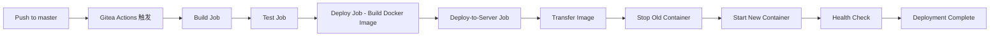

# MyBlog 部署策略说明

## 📋 部署范围

### ✅ 本次部署影响的服务

**仅重启后端容器**：
- `myblog-backend` - Spring Boot 后端应用

### ❌ 不受影响的服务

以下服务**不会**被重启或修改：
- `myblog-postgres` - PostgreSQL 数据库
- `myblog-redis` - Redis 缓存
- `myblog-minio` - MinIO 对象存储
- `myblog-frontend` - Apache 前端服务

---

## 🔧 工作流程

### 1. 构建阶段（build job）
```bash
./gradlew build -x test --no-daemon --build-cache
```
- 编译 Java 代码
- 生成 JAR 文件到 `build/libs/`
- 上传为 artifact

### 2. 测试阶段（test job）
```bash
./gradlew test
```
- 运行单元测试（可选）
- 使用临时数据库和 Redis

### 3. Docker 镜像构建（deploy job）
```dockerfile
FROM eclipse-temurin:21-jre-alpine
COPY build/libs/*-SNAPSHOT.jar app.jar
```
- 基于 Alpine JRE 轻量级镜像
- 复制 Gradle 构建的 Boot JAR 文件（排除 plain jar）
- 保存为 `myblog-backend.tar`

**注意**: Gradle 会生成两个 JAR 文件：
- `*-SNAPSHOT.jar` - Boot JAR（可执行，包含所有依赖）
- `*-SNAPSHOT-plain.jar` - Plain JAR（不可执行，仅项目代码）

### 4. 部署到服务器（deploy-to-server job）

#### 步骤 1: 传输镜像
```bash
scp myblog-backend.tar user@server:/tmp/
```

#### 步骤 2: 加载镜像
```bash
docker load < /tmp/myblog-backend.tar
rm /tmp/myblog-backend.tar
```

#### 步骤 3: 停止旧容器
```bash
docker stop myblog-backend || true
docker rm myblog-backend || true
```

#### 步骤 4: 启动新容器
```bash
docker run -d \
  --name myblog-backend \
  --network myblog-deploy_myblog-network \
  -p 18080:8080 \
  -e SPRING_DATASOURCE_URL=jdbc:postgresql://myblog-postgres:5432/myblog \
  -e SPRING_DATASOURCE_USERNAME=xxx \
  -e SPRING_DATASOURCE_PASSWORD=xxx \
  -e SPRING_DATA_REDIS_HOST=myblog-redis \
  -e SPRING_DATA_REDIS_PORT=6379 \
  -e MINIO_ENDPOINT=http://myblog-minio:9000 \
  -e MINIO_ACCESS_KEY=xxx \
  -e MINIO_SECRET_KEY=xxx \
  -e MINIO_BUCKET_NAME=myblog \
  -e JWT_SECRET=xxx \
  -e SPRING_PROFILES_ACTIVE=prod \
  --restart unless-stopped \
  myblog-backend:latest
```

#### 步骤 5: 健康检查
```bash
curl http://localhost:18080/actuator/health
# 最多重试 6 次，每次间隔 5 秒
```

---

## 🔒 安全性

### 环境变量管理
所有敏感信息通过 Gitea Secrets 管理：
- `DB_NAME`, `DB_USER`, `DB_PASSWORD` - 数据库配置
- `MINIO_ROOT_USER`, `MINIO_ROOT_PASSWORD`, `MINIO_BUCKET_NAME` - MinIO 配置
- `JWT_SECRET` - JWT 密钥
- `DEPLOY_KEY`, `DEPLOY_HOST`, `DEPLOY_USER` - SSH 部署配置

### 网络隔离
- 后端容器连接到 `myblog-deploy_myblog-network`
- 通过容器名访问其他服务（postgres, redis, minio）
- 外部只能通过 18080 端口访问后端

---

## 📊 优势

### 1. 最小化影响
- ✅ 只重启后端容器
- ✅ 数据库、Redis、MinIO 持续运行
- ✅ 前端服务不受影响
- ✅ 用户会话保持（Redis 中）

### 2. 快速回滚
如果新版本有问题：
```bash
# 停止新容器
docker stop myblog-backend
docker rm myblog-backend

# 启动旧版本镜像
docker run -d --name myblog-backend myblog-backend:previous-tag
```

### 3. 零停机部署（可选优化）
未来可以实现蓝绿部署：
```bash
# 启动新版本
docker run -d --name myblog-backend-v2 ...

# 健康检查通过后切换流量
# 停止旧版本
docker stop myblog-backend-v1
```

---

## ⚠️ 注意事项

### 1. 数据库迁移
如果有数据库 schema 变更：
- 确保 Flyway/Liquibase 脚本已准备好
- 在部署前备份数据库
- 监控迁移日志

### 2. 缓存清理
部署后可能需要清理 Redis 缓存：
```bash
docker exec myblog-redis redis-cli FLUSHDB
```

### 3. 日志监控
部署后检查日志：
```bash
docker logs myblog-backend --tail 100 -f
```

### 4. 健康检查
确认应用正常：
```bash
curl http://localhost:18080/actuator/health
curl http://localhost:18080/api/posts?page=1&size=10
```

---

## 🔄 自动化流程



---

**最后更新**: 2026-05-17  
**维护人员**: Leo
