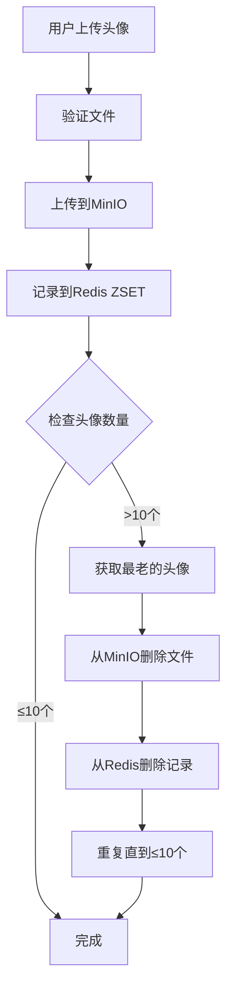

# 头像历史管理功能说明

## 📋 功能概述

系统会自动管理用户的头像历史，确保每个用户最多保留 **10个** 最近的头像。当用户上传新头像导致总数超过限制时，系统会自动删除最老的头像。

---

## 🎯 核心特性

### 1. 自动限制数量
- ✅ 每个用户最多保留 10 个头像
- ✅ 超出限制时自动删除最老的头像
- ✅ 同时清理 MinIO 存储和 Redis 记录

### 2. 智能清理策略
- 🕒 基于上传时间排序（使用时间戳）
- 🗑️ 优先删除最早的头像
- 🔄 上传新头像时自动触发清理

### 3. 双重存储管理
- 💾 **MinIO**：存储实际的图片文件
- 🔴 **Redis**：记录头像历史和上传时间

---

## 🔧 技术实现

### 数据结构

#### Redis Sorted Set
```
Key: avatar:history:{userId}
Type: ZSET (Sorted Set)

Member: MinIO对象路径（如：avatars/123/uuid.jpg）
Score: 上传时间戳（毫秒）
```

**示例**：
```
ZSET avatar:history:1
  - "avatars/1/abc-123.jpg"      score: 1714291200000
  - "avatars/1/def-456.jpg"      score: 1714377600000
  - "avatars/1/ghi-789.jpg"      score: 1714464000000
  ...
```

### 工作流程



---

## 📊 配置参数

在 `AvatarUploadService` 中定义：

```java
// 最大保留头像数量
private static final int MAX_AVATAR_COUNT = 10;

// Redis Key 前缀
private static final String AVATAR_HISTORY_PREFIX = "avatar:history:";

// Redis 数据过期时间（防止无限增长）
redisTemplate.expire(key, 30, TimeUnit.DAYS);
```

---

## 🔍 监控与调试

### 查看用户的头像历史

使用 Redis CLI：

```bash
# 连接到 Redis
redis-cli

# 查看某用户的所有头像历史（按时间排序）
ZRANGE avatar:history:1 0 -1 WITHSCORES

# 查看头像数量
ZCARD avatar:history:1

# 查看最新的5个头像
ZREVRANGE avatar:history:1 0 4 WITHSCORES
```

**输出示例**：
```
1) "avatars/1/550e8400-e29b-41d4-a716-446655440000.jpg"
2) "1714464000000"
3) "avatars/1/6ba7b810-9dad-11d1-80b4-00c04fd430c8.jpg"
4) "1714377600000"
```

### 日志输出

系统会记录详细的操作日志：

```log
# 正常上传
INFO  头像上传成功: userId=1, objectPath=avatars/1/abc-123.jpg

# 开始清理
INFO  开始清理旧头像: userId=1, 总数=11, 删除数量=1

# 删除单个头像
INFO  已删除旧头像: avatars/1/old-avatar.jpg

# 清理完成
INFO  旧头像清理完成: userId=1, 剩余数量=10
```

---

## ⚠️ 注意事项

### 1. Redis 数据过期
- 头像历史记录设置 30 天过期
- 如果用户 30 天未上传头像，历史记录会被自动清除
- 这不会影响数据库中当前使用的头像

### 2. 数据库与存储的一致性
- **数据库**：只存储当前使用的头像路径
- **MinIO**：可能保留最多 10 个历史头像文件
- **Redis**：记录所有历史头像及其上传时间

### 3. 并发上传
- 如果用户快速连续上传多个头像，可能会短暂超过 10 个
- 每次上传都会触发清理，最终会回到 10 个以内

### 4. 手动清理
如果需要手动清理某个用户的所有历史头像：

```bash
# Redis CLI
DEL avatar:history:1

# 或者删除 MinIO 中的所有头像文件
# 需要使用 MinIO 客户端或 API
```

---

## 🧪 测试场景

### 场景1：正常上传（未超限）

```bash
# 第1次上传
POST /api/users/me/avatar
→ 成功，Redis 中有 1 个记录

# 第5次上传
POST /api/users/me/avatar
→ 成功，Redis 中有 5 个记录

# 第10次上传
POST /api/users/me/avatar
→ 成功，Redis 中有 10 个记录
```

### 场景2：超出限制触发清理

```bash
# 已有10个头像，上传第11个
POST /api/users/me/avatar

# 预期行为：
# 1. 上传新头像成功
# 2. Redis 中临时有 11 个记录
# 3. 自动删除最老的 1 个头像
# 4. 最终 Redis 中保留 10 个记录
# 5. MinIO 中最老的文件被删除
```

### 场景3：批量上传测试

```bash
# 连续上传 15 次
for i in {1..15}; do
  curl -X POST http://localhost:8080/api/users/me/avatar \
    -H "Authorization: Bearer TOKEN" \
    -F "file=@avatar$i.jpg"
done

# 预期结果：
# - Redis 中只有最新的 10 个记录
# - MinIO 中只有最新的 10 个文件
# - 数据库中使用的是最后上传的那个
```

---

## 🛠️ 维护建议

### 1. 定期检查
建议定期检查 Redis 中的头像历史记录：

```bash
# 查看所有用户的头像历史Key
KEYS avatar:history:*

# 检查是否有异常多的记录
ZRANGE avatar:history:1 0 -1 | wc -l
```

### 2. 清理孤儿数据
如果数据库中的头像路径在 MinIO 中不存在，可能是被清理了：

```sql
-- 查找可能的孤儿记录
SELECT id, username, avatar 
FROM t_user 
WHERE avatar IS NOT NULL 
  AND avatar NOT IN (
    -- 这里需要结合 MinIO 列表查询
  );
```

### 3. 备份策略
如果需要保留所有历史头像，可以：
- 调整 `MAX_AVATAR_COUNT` 为更大的值
- 或者将删除的头像移动到归档存储桶
- 或者禁用自动清理功能

---

## 📈 性能影响

### 上传性能
- ✅ 额外开销很小（Redis 操作 < 1ms）
- ✅ 清理操作异步执行，不阻塞上传
- ✅ 通常只删除 1-2 个文件

### 存储空间
- 💾 MinIO：最多 10 个头像 × 平均 200KB = 约 2MB/用户
- 🔴 Redis：每个记录约 100 字节 × 10 = 约 1KB/用户

### 示例计算
假设有 1000 个活跃用户：
- MinIO 存储：1000 × 2MB = 2GB
- Redis 内存：1000 × 1KB = 1MB

---

## 🔄 升级迁移

如果之前已经有很多用户上传了头像，可以运行以下脚本初始化历史记录：

```java
/**
 * 迁移脚本：为现有用户初始化头像历史
 * 只需运行一次
 */
public void migrateExistingAvatars() {
    List<User> users = userMapper.selectList(
        new LambdaQueryWrapper<User>()
            .isNotNull(User::getAvatar)
    );
    
    for (User user : users) {
        String key = AVATAR_HISTORY_PREFIX + user.getId();
        // 检查是否已有记录
        if (!Boolean.TRUE.equals(redisTemplate.hasKey(key))) {
            // 添加当前头像到历史
            double score = System.currentTimeMillis();
            redisTemplate.opsForZSet().add(key, user.getAvatar(), score);
            log.info("为用户 {} 初始化头像历史", user.getId());
        }
    }
}
```

---

## ❓ 常见问题

### Q1: 为什么选择 10 个作为限制？
A: 这是一个平衡点：
- 太少：用户无法回滚到之前的头像
- 太多：浪费存储空间
- 10 个足够用户回顾和选择

### Q2: 能否自定义限制数量？
A: 可以，修改 `MAX_AVATAR_COUNT` 常量即可：
```java
private static final int MAX_AVATAR_COUNT = 20; // 改为20个
```

### Q3: 删除的头像能恢复吗？
A: 不能。一旦从 MinIO 删除，文件就永久丢失了。如果需要恢复功能，建议：
- 增加保留数量
- 或者实现软删除（移动到回收站）

### Q4: Redis 数据丢失怎么办？
A: 影响有限：
- 只是失去历史记录，不影响当前头像
- 下次上传时会重新建立历史记录
- MinIO 中的文件仍然存在，直到达到限制

### Q5: 如何查看某个用户还有哪些历史头像？
A: 可以通过 MinIO 列出该用户目录下的所有文件：
```bash
mc ls myminio/myblog/avatars/1/
```

---

## 📝 总结

头像历史管理功能提供了：
- ✅ 自动限制存储数量
- ✅ 智能清理旧头像
- ✅ 节省存储空间
- ✅ 保持系统整洁
- ✅ 用户友好的回滚能力

通过 Redis + MinIO 的组合，实现了高效、可靠的头像历史管理。
