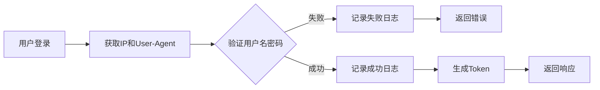

# 登录设备信息记录功能

## 📋 功能概述

本功能用于记录用户登录时的设备信息，包括：
- **IP地址**：客户端的真实IP
- **操作系统**：Windows、macOS、Linux、iOS、Android等
- **浏览器**：Chrome、Firefox、Safari、Edge等
- **设备类型**：桌面电脑、手机、平板

这些信息会：
1. 存储在 `t_login_log` 表中
2. 在审计日志的 `extraData` 字段中显示

---

## 🗄️ 数据库设计

### t_login_log 表结构

| 字段 | 类型 | 说明 |
|------|------|------|
| id | BIGINT | 主键ID（雪花算法） |
| user_id | BIGINT | 用户ID |
| username | VARCHAR(50) | 用户名 |
| ip_address | VARCHAR(50) | 登录IP地址 |
| device_type | VARCHAR(20) | 设备类型：DESKTOP/MOBILE/TABLET/UNKNOWN |
| os_name | VARCHAR(50) | 操作系统名称 |
| os_version | VARCHAR(50) | 操作系统版本 |
| browser_name | VARCHAR(50) | 浏览器名称 |
| browser_version | VARCHAR(50) | 浏览器版本 |
| user_agent | TEXT | 原始User-Agent字符串 |
| login_time | TIMESTAMP | 登录时间 |
| login_result | VARCHAR(20) | 登录结果：SUCCESS/FAILED |
| failure_reason | VARCHAR(200) | 失败原因 |

### 索引

- `idx_login_log_user_id`: 按用户查询
- `idx_login_log_username`: 按用户名查询
- `idx_login_log_login_time`: 按时间排序
- `idx_login_log_ip_address`: 按IP查询

---

## 🔧 实现细节

### 1. User-Agent 解析

使用 [UserAgentParser.java](../src/main/java/com/leo/myblog/util/UserAgentParser.java) 工具类解析 User-Agent 字符串。

**示例**：
```
User-Agent: Mozilla/5.0 (Windows NT 10.0; Win64; x64) AppleWebKit/537.36 (KHTML, like Gecko) Chrome/120.0.0.0 Safari/537.36

解析结果：
- deviceType: DESKTOP
- osName: Windows
- osVersion: 10/11
- browserName: Chrome
- browserVersion: 120.0.0.0
```

### 2. 登录流程



### 3. 审计日志集成

在 [AuditLogAspect.java](../src/main/java/com/leo/myblog/aspect/AuditLogAspect.java) 中，当检测到 LOGIN 操作时，自动将设备信息添加到 `extraData` 字段。

**审计日志 extraData 示例**：
```json
{
  "userAgent": "Mozilla/5.0 (Windows NT 10.0; Win64; x64)...",
  "deviceType": "DESKTOP",
  "osName": "Windows",
  "browserName": "Chrome"
}
```

---

## 📊 数据示例

### 登录成功记录

```sql
SELECT * FROM t_login_log WHERE username = 'admin' ORDER BY login_time DESC LIMIT 1;
```

**结果**：
```
id: 2054800000000000001
user_id: 1
username: admin
ip_address: 192.168.1.100
device_type: DESKTOP
os_name: Windows
os_version: 10/11
browser_name: Chrome
browser_version: 120.0.0.0
user_agent: Mozilla/5.0 (Windows NT 10.0; Win64; x64)...
login_time: 2026-05-14 15:30:00
login_result: SUCCESS
failure_reason: NULL
```

### 登录失败记录

```sql
SELECT * FROM t_login_log WHERE login_result = 'FAILED' ORDER BY login_time DESC LIMIT 1;
```

**结果**：
```
id: 2054800000000000002
user_id: NULL
username: admin
ip_address: 192.168.1.100
device_type: DESKTOP
os_name: Windows
os_version: 10/11
browser_name: Chrome
browser_version: 120.0.0.0
user_agent: Mozilla/5.0 (Windows NT 10.0; Win64; x64)...
login_time: 2026-05-14 15:29:00
login_result: FAILED
failure_reason: 密码错误
```

---

## 🔍 查询示例

### 1. 查看用户的最近登录记录

```sql
SELECT 
    login_time,
    ip_address,
    device_type,
    os_name,
    browser_name,
    login_result
FROM t_login_log
WHERE user_id = 1
ORDER BY login_time DESC
LIMIT 10;
```

### 2. 查看某IP的所有登录记录（安全审计）

```sql
SELECT 
    username,
    login_time,
    login_result,
    failure_reason
FROM t_login_log
WHERE ip_address = '192.168.1.100'
ORDER BY login_time DESC;
```

### 3. 统计各设备的登录次数

```sql
SELECT 
    device_type,
    COUNT(*) as login_count
FROM t_login_log
WHERE login_result = 'SUCCESS'
GROUP BY device_type
ORDER BY login_count DESC;
```

### 4. 查看最近的失败登录尝试

```sql
SELECT 
    username,
    ip_address,
    login_time,
    failure_reason
FROM t_login_log
WHERE login_result = 'FAILED'
ORDER BY login_time DESC
LIMIT 20;
```

---

## 🛡️ 安全用途

### 1. 异常登录检测

```sql
-- 查找短时间内多次失败登录的IP
SELECT 
    ip_address,
    COUNT(*) as failure_count,
    MIN(login_time) as first_attempt,
    MAX(login_time) as last_attempt
FROM t_login_log
WHERE login_result = 'FAILED'
  AND login_time > NOW() - INTERVAL '1 hour'
GROUP BY ip_address
HAVING COUNT(*) > 5
ORDER BY failure_count DESC;
```

### 2. 异地登录检测

```sql
-- 查看同一用户的不同IP登录
SELECT DISTINCT
    user_id,
    username,
    ip_address,
    login_time
FROM t_login_log
WHERE user_id = 1
  AND login_result = 'SUCCESS'
ORDER BY login_time DESC
LIMIT 10;
```

### 3. 可疑设备检测

```sql
-- 查找不常见的设备类型
SELECT 
    username,
    device_type,
    os_name,
    browser_name,
    login_time
FROM t_login_log
WHERE device_type NOT IN ('DESKTOP', 'MOBILE', 'TABLET')
ORDER BY login_time DESC;
```

---

## 📝 API 扩展建议

未来可以添加以下API：

### 1. 获取当前用户的登录历史

```
GET /api/users/me/login-history?pageNum=1&pageSize=20
```

**响应**：
```json
{
  "code": 200,
  "data": {
    "records": [
      {
        "id": "2054800000000000001",
        "ipAddress": "192.168.1.100",
        "deviceType": "DESKTOP",
        "osName": "Windows",
        "browserName": "Chrome",
        "loginTime": "2026-05-14T15:30:00",
        "loginResult": "SUCCESS"
      }
    ],
    "total": 50
  }
}
```

### 2. 管理员查看所有用户的登录日志

```
GET /api/admin/login-logs?username=admin&pageNum=1&pageSize=20
```

### 3. 获取登录统计信息

```
GET /api/admin/login-stats
```

**响应**：
```json
{
  "code": 200,
  "data": {
    "todayLogins": 150,
    "failedAttempts": 23,
    "uniqueIps": 89,
    "deviceDistribution": {
      "DESKTOP": 120,
      "MOBILE": 25,
      "TABLET": 5
    }
  }
}
```

---

## 🎯 相关文件

- [V17__create_login_log_table.sql](../src/main/resources/db/migration/V17__create_login_log_table.sql) - 数据库迁移脚本
- [LoginLog.java](../src/main/java/com/leo/myblog/entity/LoginLog.java) - 登录日志实体
- [LoginLogMapper.java](../src/main/java/com/leo/myblog/mapper/LoginLogMapper.java) - Mapper接口
- [LoginLogService.java](../src/main/java/com/leo/myblog/service/LoginLogService.java) - 服务层
- [UserAgentParser.java](../src/main/java/com/leo/myblog/util/UserAgentParser.java) - User-Agent解析工具
- [UserService.java](../src/main/java/com/leo/myblog/service/UserService.java) - 登录逻辑修改
- [AuditLogAspect.java](../src/main/java/com/leo/myblog/aspect/AuditLogAspect.java) - 审计日志集成

---

## 💡 注意事项

1. **隐私保护**：User-Agent 可能包含敏感信息，确保符合隐私政策
2. **存储优化**：定期清理旧的登录日志（建议保留90天）
3. **性能考虑**：登录日志写入是异步的，不影响登录性能
4. **索引维护**：定期检查索引使用情况，优化查询性能

---

**更新日期**: 2026-05-14  
**版本**: 1.0
