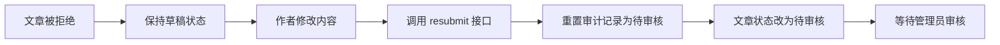

# 重新提交审核功能说明

## 📋 问题背景

**错误信息**：
```
ERROR: 待审核文章必须有待审核的审计记录
```

**原因**：
- 前端尝试通过 `PUT /api/posts/{postId}` 直接将已拒绝的文章改为待审核状态（status=3）
- 数据库触发器阻止了这种操作，因为已拒绝的文章审计状态是 `audit_status=2`，而不是 `0`（待审核）

---

## ✅ 解决方案

### 新增接口：重新提交审核

添加了专门的接口用于已拒绝的文章重新进入审核流程。

#### API 端点

```
POST /api/posts/audit/{postId}/resubmit
```

#### 请求参数

| 参数 | 类型 | 位置 | 必填 | 说明 |
|------|------|------|------|------|
| postId | Long | Path | ✅ | 文章ID |
| Authorization | String | Header | ✅ | Bearer Token |

#### 响应示例

**成功**：
```json
{
  "code": 200,
  "message": "已重新提交审核",
  "data": null
}
```

**失败**：
```json
{
  "code": 400,
  "message": "只有文章作者可以重新提交审核",
  "data": null
}
```

---

## 🔄 业务流程

### 正确的操作流程



### 错误的操作流程 ❌

```
❌ 直接调用 PUT /api/posts/{postId} 并设置 status=3
   → 触发器拦截
   → 返回错误："待审核文章必须有待审核的审计记录"
```

---

## 💻 前端使用示例

### Axios 调用

```javascript
// 重新提交审核
const resubmitForAudit = async (postId) => {
  try {
    const response = await axios.post(
      `/api/posts/audit/${postId}/resubmit`,
      {},
      {
        headers: {
          'Authorization': `Bearer ${token}`
        }
      }
    );
    
    console.log('重新提交成功:', response.data.message);
    return response.data;
  } catch (error) {
    console.error('重新提交失败:', error.response?.data?.message);
    throw error;
  }
};

// 使用示例
await resubmitForAudit('2054777653973684225');
```

### Vue 组件示例

```vue
<template>
  <div v-if="post.auditStatus === 2">
    <p class="text-red-500">文章已被拒绝</p>
    <p class="text-gray-600">拒绝原因：{{ post.auditComment }}</p>
    
    <!-- 修改文章内容后 -->
    <button 
      @click="handleResubmit"
      :disabled="submitting"
      class="btn btn-primary"
    >
      {{ submitting ? '提交中...' : '重新提交审核' }}
    </button>
  </div>
</template>

<script setup>
import { ref } from 'vue';
import axios from 'axios';

const props = defineProps({
  postId: String
});

const submitting = ref(false);

const handleResubmit = async () => {
  submitting.value = true;
  
  try {
    await axios.post(`/api/posts/audit/${props.postId}/resubmit`);
    alert('已重新提交审核');
    // 刷新页面或更新状态
  } catch (error) {
    alert(error.response?.data?.message || '提交失败');
  } finally {
    submitting.value = false;
  }
};
</script>
```

---

## 🔒 权限控制

### 谁可以重新提交？

- ✅ **文章作者**：可以重新提交自己的文章
- ❌ **其他用户**：无权操作
- ❌ **管理员**：不能代替作者重新提交（需要作者自己操作）

### 什么情况下可以重新提交？

| 审计状态 | 是否可以重新提交 | 说明 |
|---------|----------------|------|
| 0 (待审核) | ❌ | 已在审核中，无需重复提交 |
| 1 (已通过) | ❌ | 已通过审核，无需重新提交 |
| 2 (已拒绝) | ✅ | **允许**：修改后可重新提交 |
| NULL (无记录) | ✅ | 创建新的审计记录 |

---

## 🛡️ 后端实现细节

### Controller 层

```java
@PostMapping("/{postId}/resubmit")
public Result<Void> resubmitForAudit(@RequestAttribute Long userId,
                                      @PathVariable Long postId) {
    log.info("重新提交审核: userId={}, postId={}", userId, postId);
    postAuditService.resubmitForAudit(userId, postId);
    return Result.success("已重新提交审核", null);
}
```

### Service 层逻辑

```java
@Transactional(rollbackFor = Exception.class)
public void resubmitForAudit(Long userId, Long postId) {
    // 1. 验证文章是否存在
    // 2. 验证权限：只有作者可以重新提交
    // 3. 查询审计记录
    // 4. 如果无记录，创建新记录
    // 5. 如果有记录，检查是否允许重新提交
    // 6. 重置审计记录为待审核状态
    // 7. 更新文章状态为待审核（status=3）
}
```

### 数据库触发器保护

触发器确保：
- ✅ 待审核的文章必须有 `audit_status=0` 的审计记录
- ✅ 已拒绝的文章不能直接改为待审核，必须通过 `resubmit` 接口

---

## 📊 状态转换图

```
┌─────────┐     提交审核      ┌──────────┐
│  草稿    │ ──────────────→ │  待审核   │
│ (status=0)│                 │(status=3)│
└─────────┘                   └────┬─────┘
       ↑                           │
       │                           │ 管理员审核
       │                    ┌──────┴──────┐
       │                    │             │
       │              通过 (status=1)  拒绝 (status=0)
       │                    │             │
       │                    ↓             ↓
       │              ┌──────────┐  ┌─────────┐
       │              │  已发布   │  │  草稿    │
       │              │(status=1)│  │(status=0)│
       │              └──────────┘  └────┬────┘
       │                                 │
       │                          作者修改后
       │                          重新提交
       └─────────────────────────────────┘
```

---

## 🧪 测试用例

### 测试1：正常重新提交流程

```bash
# 1. 查看当前状态
curl -X GET "http://localhost:8080/api/posts/audit/2054777653973684225/record" \
  -H "Authorization: Bearer YOUR_TOKEN"

# 预期：audit_status=2 (已拒绝)

# 2. 重新提交
curl -X POST "http://localhost:8080/api/posts/audit/2054777653973684225/resubmit" \
  -H "Authorization: Bearer YOUR_TOKEN"

# 预期：200 OK, message="已重新提交审核"

# 3. 验证状态
curl -X GET "http://localhost:8080/api/posts/audit/2054777653973684225/record" \
  -H "Authorization: Bearer YOUR_TOKEN"

# 预期：audit_status=0 (待审核), article status=3
```

### 测试2：非作者尝试重新提交

```bash
# 使用其他用户的Token
curl -X POST "http://localhost:8080/api/posts/audit/2054777653973684225/resubmit" \
  -H "Authorization: Bearer OTHER_USER_TOKEN"

# 预期：400, message="只有文章作者可以重新提交审核"
```

### 测试3：重复提交

```bash
# 第一次提交
curl -X POST "http://localhost:8080/api/posts/audit/2054777653973684225/resubmit" \
  -H "Authorization: Bearer YOUR_TOKEN"

# 第二次提交（应该失败）
curl -X POST "http://localhost:8080/api/posts/audit/2054777653973684225/resubmit" \
  -H "Authorization: Bearer YOUR_TOKEN"

# 预期：400, message="文章已在待审核状态，无需重复提交"
```

---

## 📝 相关文件

- [PostAuditController.java](../src/main/java/com/leo/myblog/controller/PostAuditController.java)
- [PostAuditService.java](../src/main/java/com/leo/myblog/service/PostAuditService.java)
- [V15__add_post_audit_consistency_trigger.sql](../src/main/resources/db/migration/V15__add_post_audit_consistency_trigger.sql)
- [POST_AUDIT_CONSISTENCY_PROTECTION.md](POST_AUDIT_CONSISTENCY_PROTECTION.md)

---

**更新日期**: 2026-05-14  
**版本**: 1.0
