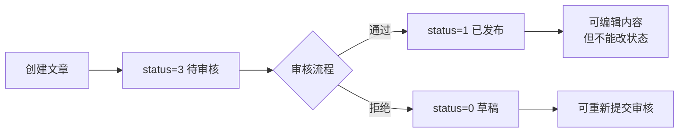

# 文章状态修改安全漏洞修复

## 🚨 漏洞描述

### 问题
在修复前，`POST /api/posts/{postId}` (PUT方法) 接口允许用户通过 `UpdatePostRequest` 中的 `status` 字段直接修改文章状态，这会导致：

1. **绕过审核流程**：待审核文章（status=3）可以直接被作者修改为已发布状态（status=1）
2. **权限越权**：非管理员用户可以随意改变文章状态
3. **数据一致性破坏**：审计记录与实际文章状态不同步

### 攻击场景
```
1. 用户创建文章 → 自动设置为 status=3（待审核）
2. 用户调用 PUT /api/posts/{id}，传入 {"status": 1}
3. 文章直接变为已发布状态，绕过了审核流程 ❌
```

---

## ✅ 修复方案

### 核心原则
**文章状态的变更必须通过专门的审核流程，不能通过普通的更新接口修改。**

### 实现细节

#### 1. 待审核文章的严格保护
```java
// 待审核文章(status=3)：任何人都不能通过此接口修改状态
if (post.getStatus() == 3) {
    throw new BusinessException("待审核文章不能通过此接口修改状态，必须通过审核流程");
}
```

**说明**：
- 无论是否为管理员，都不能通过 `updatePost` 接口修改待审核文章的状态
- 必须使用专门的审核接口 `POST /api/posts/audit/{postId}`

#### 2. 非管理员用户限制
```java
// 非管理员：不能修改任何文章的状态
if (!isAdmin) {
    log.debug("非管理员尝试修改文章状态，忽略状态变更: postId={}, userId={}", postId, userId);
    // 不修改status字段，保持原状态
}
```

**说明**：
- 非管理员用户在更新文章时，即使传入了 `status` 字段也会被忽略
- 只允许更新文章内容（标题、内容、分类、标签等）

#### 3. 管理员的部分权限
```java
// 管理员：可以修改状态，但不能直接发布待审核文章
if (post.getStatus() == 3 && request.getStatus() == 1) {
    throw new BusinessException("待审核文章不能直接设置为已发布，必须通过审核流程");
}

// 管理员可以修改其他状态（如草稿↔私密）
post.setStatus(request.getStatus());
```

**说明**：
- 管理员可以修改已发布文章的状态（如设为私密）
- 但**不能**直接将待审核文章改为已发布，必须走审核流程
- 确保审核流程的严肃性和可追溯性

---

## 🔐 正确的文章状态流转

### 正常流程



### 各状态的修改权限

| 当前状态 | 作者能做什么 | 管理员能做什么 | 审核员能做什么 |
|---------|------------|--------------|--------------|
| **0-草稿** | 编辑内容、删除 | 编辑内容、删除、改变状态 | 无（草稿不需审核） |
| **1-已发布** | 编辑内容（不能改状态） | 编辑内容、改变状态 | 无 |
| **2-私密** | 编辑内容、删除 | 编辑内容、改变状态 | 无 |
| **3-待审核** | 编辑内容（不能改状态） | 编辑内容（不能改状态） | 审核通过/拒绝 ⭐ |

---

## 📋 相关API接口

### 1. 更新文章内容（不能修改状态）
```
PUT /api/posts/{postId}
Body: {
  "title": "...",
  "content": "...",
  "categoryId": 1,
  "tagIds": [1, 2],
  "status": 1  // ← 这个字段会被忽略或拒绝
}
```

**行为**：
- 待审核文章：抛出异常，禁止修改状态
- 已发布文章：非管理员的状态修改被忽略，管理员可以修改（但不能从待审核直接发布）

### 2. 审核文章（唯一的状态变更入口）
```
POST /api/posts/audit/{postId}
需要能力: audit_posts
Body: {
  "auditStatus": 1,  // 1-通过, 2-拒绝
  "auditComment": "内容质量良好"
}
```

**行为**：
- 只有拥有 `audit_posts` 能力的管理员可以调用
- 审核通过 → status=1, publish_time=now
- 审核拒绝 → status=0

---

## 🧪 测试验证

### 自动化测试脚本
```bash
./scripts/tests/test_post_status_bypass.sh
```

### 测试用例

#### 测试1：待审核文章不能被作者直接发布
```bash
# 创建文章（自动进入待审核）
POST /api/posts
{
  "title": "测试文章",
  "content": "测试内容",
  "status": 1  // 即使传入1，也会被设置为3
}

# 尝试修改状态为已发布
PUT /api/posts/{id}
{
  "title": "修改后的标题",
  "content": "修改后的内容",
  "status": 1  // ❌ 应该被拒绝
}

# 预期结果：400 Bad Request
# 错误信息："待审核文章不能通过此接口修改状态，必须通过审核流程"
```

#### 测试2：非管理员不能修改已发布文章状态
```bash
# 普通用户尝试将已发布文章设为私密
PUT /api/posts/{id}
{
  "status": 2  // ❌ 应该被忽略
}

# 预期结果：200 OK（文章其他字段更新成功）
# 但status保持为1，没有被修改
```

#### 测试3：审核流程正常工作
```bash
# 审核员审核文章
POST /api/posts/audit/{id}
{
  "auditStatus": 1,
  "auditComment": "内容符合要求"
}

# 预期结果：文章状态变为1（已发布），publish_time被设置
```

---

## 📝 代码变更清单

### 修改的文件
1. **PostServiceImpl.java** - `updatePost()` 方法
   - 添加待审核文章的保护逻辑
   - 添加非管理员的状态修改限制
   - 添加管理员的特殊规则

### 新增的文件
1. **test_post_status_bypass.sh** - 自动化测试脚本
2. **POST_STATUS_SECURITY_FIX.md** - 本文档

---

## 🔍 审计与监控

### 日志记录
所有尝试修改文章状态的操作都会被记录：

```java
log.debug("非管理员尝试修改文章状态，忽略状态变更: postId={}, userId={}", postId, userId);
```

### 异常监控
以下异常应该触发告警：
- "待审核文章不能通过此接口修改状态，必须通过审核流程"
- 频繁的权限拒绝错误

---

## 🚀 部署建议

1. **立即部署**：这是一个安全修复，应优先部署
2. **检查日志**：部署后检查是否有大量"尝试修改状态"的日志，可能存在恶意用户
3. **数据审计**：检查是否有文章在不应该有 audit_record 的情况下变成了已发布状态
4. **通知前端**：告知前端团队不要再依赖 updatePost 接口修改状态

---

## 📚 相关文档

- [文章审计系统完整指南](POST_AUDIT_SYSTEM_GUIDE.md)
- [文章审计系统完成报告](POST_AUDIT_COMPLETE.md)
- [审计日志系统](AUDIT_LOG_SYSTEM.md)

---

**修复日期**: 2026-05-14  
**修复人员**: Leo  
**安全等级**: 🔴 高优先级  
**影响范围**: 所有文章管理功能
