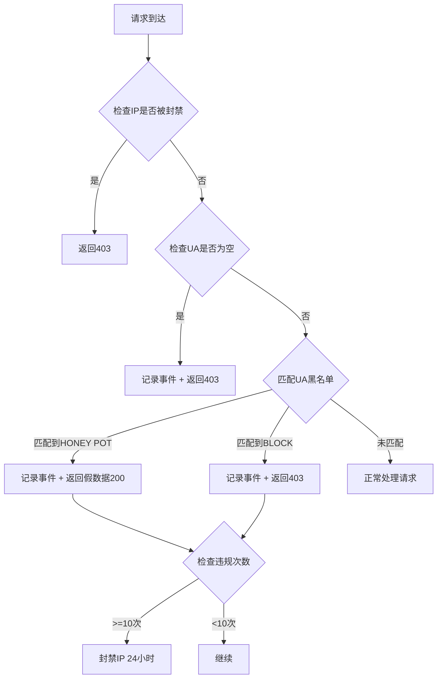

# UA安全拦截系统

## 📋 功能概述

本系统用于拦截恶意User-Agent，防止扫描器和自动化攻击工具访问系统。

### 核心功能

1. **UA黑名单拦截**：拦截Kali、sqlmap、nmap等安全工具
2. **蜜罐机制**：对高危威胁返回假数据，消耗攻击者时间
3. **IP自动封禁**：多次违规的IP自动封禁24小时
4. **安全事件日志**：记录所有可疑访问行为

---

## 🗄️ 数据库设计

### 1. t_ua_blacklist - UA黑名单表

| 字段 | 类型 | 说明 |
|------|------|------|
| id | BIGINT | 主键ID |
| pattern | VARCHAR(200) | UA匹配模式（部分匹配） |
| description | VARCHAR(500) | 描述 |
| threat_level | VARCHAR(20) | 威胁等级：LOW/MEDIUM/HIGH/CRITICAL |
| action_type | VARCHAR(20) | 动作：BLOCK（拦截）/HONEYPOT（蜜罐） |
| is_enabled | BOOLEAN | 是否启用 |

### 2. t_security_event - 安全事件表

记录所有被拦截的请求，用于安全审计和威胁分析。

### 3. t_ip_ban - IP封禁表

临时封禁频繁违规的IP地址。

---

## 🛡️ 默认拦截规则

### 高危工具（蜜罐模式）

| 模式 | 描述 | 威胁等级 | 动作 |
|------|------|---------|------|
| kali | Kali Linux渗透测试系统 | HIGH | HONEYPOT |
| sqlmap | SQL注入扫描工具 | CRITICAL | HONEYPOT |
| nmap | 网络扫描工具 | HIGH | HONEYPOT |
| nikto | Web服务器扫描器 | HIGH | HONEYPOT |
| dirbuster | 目录爆破工具 | MEDIUM | HONEYPOT |
| w3af | Web应用攻击框架 | HIGH | HONEYPOT |
| metasploit | 渗透测试框架 | CRITICAL | HONEYPOT |

### 脚本工具（拦截模式）

| 模式 | 描述 | 威胁等级 | 动作 |
|------|------|---------|------|
| python-requests | Python脚本库 | LOW | BLOCK |
| python-urllib | Python脚本库 | LOW | BLOCK |
| go-http-client | Go语言HTTP客户端 | LOW | BLOCK |
| java/ | Java HTTP客户端 | LOW | BLOCK |
| curl/ | 命令行工具 | LOW | BLOCK |
| wget/ | 命令行下载工具 | LOW | BLOCK |

### 其他

- **空UA**：直接拦截（正常浏览器不会发送空UA）

---

## 🔧 工作原理

### 1. 请求流程



### 2. 蜜罐机制

**目的**：
- 消耗攻击者时间
- 追踪攻击行为
- 避免攻击者更换UA

**实现**：
- 返回HTTP 200状态码
- 提供伪造的数据（假文章、假用户等）
- 在数据中标记"这是蜜罐"

**示例响应**：
```json
{
  "code": 200,
  "message": "success",
  "data": {
    "id": "9999999999999999999",
    "title": "这是一篇假文章 - 你被蜜罐捕获了",
    "content": "如果你看到这条消息，说明你的扫描器正在访问蜜罐系统..."
  }
}
```

### 3. IP自动封禁

**触发条件**：
- 同一IP在24小时内违规 >= 10次

**封禁时长**：
- 24小时

**封禁存储**：
- Redis（高性能、自动过期）

**Redis键格式**：
- 违规计数：`security:violation:{ip}`
- 封禁标记：`security:banned:{ip}`

---

## 📊 安全事件记录

每次拦截都会记录以下信息：

```
时间: 2026-05-14 16:00:00
IP: 192.168.1.100
UA: sqlmap/1.5
URL: /api/posts
方法: GET
匹配规则: sqlmap
威胁等级: CRITICAL
动作: HONEYPOT
```

---

## 🔍 查询示例

### 1. 查看最近的拦截事件

```sql
SELECT 
    create_time,
    ip_address,
    user_agent,
    request_url,
    matched_pattern,
    threat_level,
    action_taken
FROM t_security_event
ORDER BY create_time DESC
LIMIT 20;
```

### 2. 统计各IP的违规次数

```sql
SELECT 
    ip_address,
    COUNT(*) as violation_count,
    MAX(create_time) as last_violation
FROM t_security_event
WHERE create_time > NOW() - INTERVAL '24 hours'
GROUP BY ip_address
HAVING COUNT(*) >= 5
ORDER BY violation_count DESC;
```

### 3. 查看当前被封禁的IP

```sql
SELECT 
    ip_address,
    reason,
    ban_until,
    trigger_count
FROM t_ip_ban
WHERE ban_until > NOW()
ORDER BY ban_until DESC;
```

### 4. 统计威胁等级分布

```sql
SELECT 
    threat_level,
    COUNT(*) as count
FROM t_security_event
WHERE create_time > NOW() - INTERVAL '7 days'
GROUP BY threat_level
ORDER BY 
    CASE threat_level 
        WHEN 'CRITICAL' THEN 1 
        WHEN 'HIGH' THEN 2 
        WHEN 'MEDIUM' THEN 3 
        WHEN 'LOW' THEN 4 
    END;
```

---

## 🧪 测试方法

### 1. 运行测试脚本

```bash
chmod +x scripts/test_ua_security.sh
./scripts/test_ua_security.sh
```

### 2. 手动测试

**测试空UA**：
```bash
curl -H "User-Agent:" http://localhost:8080/api/posts
# 预期：403 Forbidden
```

**测试Kali UA**：
```bash
curl -H "User-Agent: Mozilla/5.0 (Kali Linux)" http://localhost:8080/api/posts
# 预期：200 OK + 假数据
```

**测试sqlmap UA**：
```bash
curl -H "User-Agent: sqlmap/1.5" http://localhost:8080/api/users
# 预期：200 OK + 假数据
```

**测试python-requests UA**：
```bash
curl -H "User-Agent: python-requests/2.28.0" http://localhost:8080/api/posts
# 预期：403 Forbidden
```

**测试正常浏览器UA**：
```bash
curl -H "User-Agent: Mozilla/5.0 (Windows NT 10.0; Win64; x64) AppleWebKit/537.36 (KHTML, like Gecko) Chrome/120.0.0.0 Safari/537.36" \
  http://localhost:8080/api/posts
# 预期：200 OK + 真实数据
```

---

## ⚙️ 配置管理

### 添加新的UA规则

```sql
INSERT INTO t_ua_blacklist (pattern, description, threat_level, action_type)
VALUES ('masscan', '高速端口扫描器', 'HIGH', 'HONEYPOT');
```

### 禁用某个规则

```sql
UPDATE t_ua_blacklist 
SET is_enabled = false 
WHERE pattern = 'wget/';
```

### 修改动作为蜜罐

```sql
UPDATE t_ua_blacklist 
SET action_type = 'HONEYPOT' 
WHERE pattern = 'python-requests';
```

### 调整封禁阈值

修改 [UaSecurityFilter.java](../src/main/java/com/leo/myblog/filter/UaSecurityFilter.java)：

```java
private static final int MAX_VIOLATIONS_BEFORE_BAN = 10; // 改为其他值
private static final long BAN_DURATION_HOURS = 24; // 改为其他值
```

---

## 🚨 高级防护建议

### 1. 集成WAF

将UA黑名单同步到WAF（如ModSecurity、Cloudflare），在网络层拦截。

### 2. 联动防火墙

定期从`t_ip_ban`表读取封禁IP，同步到iptables或云安全组：

```bash
# 示例：从数据库导出封禁IP并添加到iptables
docker exec -i myblog-postgres psql -U Leoxiaoblog -d myblog -t -A -c "
SELECT ip_address FROM t_ip_ban WHERE ban_until > NOW();
" | while read ip; do
    iptables -A INPUT -s $ip -j DROP
done
```

### 3. 告警通知

当检测到CRITICAL级别威胁时，发送告警通知（邮件、钉钉、企业微信等）。

### 4. 威胁情报共享

将拦截的IP和UA上报到威胁情报平台，帮助其他系统防御。

---

## 📝 相关文件

**数据库**：
- [V18__create_ua_blacklist_tables.sql](../src/main/resources/db/migration/V18__create_ua_blacklist_tables.sql)

**代码**：
- [UaBlacklist.java](../src/main/java/com/leo/myblog/entity/UaBlacklist.java)
- [UaBlacklistMapper.java](../src/main/java/com/leo/myblog/mapper/UaBlacklistMapper.java)
- [UaSecurityFilter.java](../src/main/java/com/leo/myblog/filter/UaSecurityFilter.java)

**测试**：
- [test_ua_security.sh](../scripts/test_ua_security.sh)

---

## 💡 注意事项

1. **性能影响**：UA匹配在每次请求时执行，但使用了简单的字符串包含匹配，性能影响很小
2. **误判风险**：某些 legitimate 的工具可能使用python-requests等库，如有需要可添加白名单
3. **Redis依赖**：IP封禁功能依赖Redis，确保Redis服务正常运行
4. **日志存储**：安全事件日志会快速增长，建议定期清理（保留90天）
5. **蜜罐标识**：蜜罐数据中包含明显标识，避免被当作真实数据使用

---

## 🎯 效果评估

### 拦截效果

- ✅ 阻止常见扫描器（sqlmap、nmap等）
- ✅ 阻止自动化脚本（python-requests等）
- ✅ 阻止低级爬虫（空UA）
- ✅ 迷惑高级攻击者（蜜罐）

### 安全价值

- 📊 收集威胁情报（攻击者IP、工具、行为）
- 🔍 发现潜在攻击（高频访问、异常UA）
- 🛡️ 减少服务器负载（拦截无效请求）
- ⏱️ 消耗攻击者时间（蜜罐）

---

**更新日期**: 2026-05-14  
**版本**: 1.0
